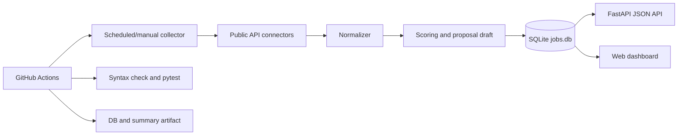

# Global Job Aggregator MVP

Safety-first MVP for collecting global job opportunities from official APIs, public JSON feeds, and ATS job-board APIs. The first production-ready version targets AI automation, RAG, OpenAI/Claude API, workflow automation, scraping-analysis, LLM evaluation, and remote/high-value roles.

## What it does

- Collects jobs from API-first sources into SQLite.
- Avoids login scraping and browser automation for platforms that prohibit it.
- Normalizes different job schemas into one `jobs` table.
- Scores AI relevance and personal fit.
- Creates a first-pass proposal draft for each job.
- Exposes a FastAPI JSON API and a simple browser dashboard.
- Runs syntax checks and tests on GitHub Actions.
- Runs scheduled collection and uploads `jobs.db` plus `collection-summary.json` as an Actions artifact.

## Sources

Enabled without API keys:

- Himalayas public Remote Jobs API
- Jobicy public API
- Arbeitnow public Job Board API

Excluded by design:

- Upwork page scraping, LinkedIn page scraping, and logged-in browser automation. Upwork should be handled manually or through approved API access only.

## Quick start

```bash
python -m venv .venv
source .venv/bin/activate
pip install -r requirements.txt
python scripts/collect_once.py --force --summary-path data/collection-summary.json
uvicorn app.main:app --reload
```

Open `http://127.0.0.1:8000`.

## API endpoints

- `GET /health`
- `GET /api/jobs?q=rag&source=himalayas&limit=50`
- `GET /api/jobs/{id}`
- `POST /api/collect?force=true`

## Configuration

Most important optional environment variables:

| Name | Purpose |
|---|---|
| `JOB_KEYWORDS` | Comma-separated target keywords. |
| `MAX_PER_SOURCE` | Maximum jobs per source. |
| `CONTACT_EMAIL` | Contact address included in the user agent. |
| `DB_PATH` | SQLite DB path. Defaults to `data/jobs.db`. |

No secret is required for the default public/API-first production run.

## Architecture

See `docs/architecture.md`.



## Testing

```bash
python -m compileall app scripts tests
pytest -q
```

## GitHub Actions

- `.github/workflows/ci.yml`: syntax check and tests on push, pull request, and manual run.
- `.github/workflows/collect.yml`: manual/scheduled collection and SQLite artifact upload.

## Safety principles

1. Use official APIs or public JSON feeds first.
2. Do not automate logged-in sessions unless the platform explicitly approves it.
3. Respect source-specific rate limits and cooldowns.
4. Store source attribution and original URLs.
5. Keep application submission human-reviewed.
