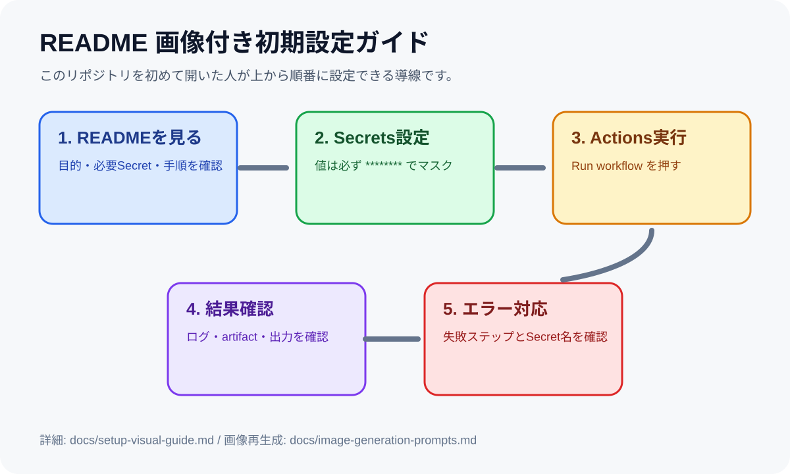
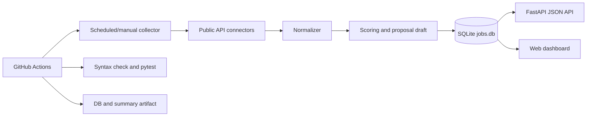

<!-- AI_README_SETUP_GUIDE_START -->
## 🧭 画像付き初期設定ガイド



このリポジトリ **global-job-aggregator-mvp** を初めて開いた人は、まずここだけ見れば初期設定から実行、成果物確認まで進められます。

### 最初にやること

1. 必要なSecretや外部サービス設定を確認します。
2. GitHub Actions または README の実行手順に沿って動かします。
3. 実行ログと成果物を確認します。
4. エラー時は Actions の失敗ステップと Secret名を確認します。

### 詳しい画像付きガイド

- [docs/setup-visual-guide.md](docs/setup-visual-guide.md)
- [docs/image-generation-prompts.md](docs/image-generation-prompts.md)

> SecretやAPIキーの実値は、README、Issue、ログ、画像に絶対に貼らないでください。例では `********` または `YOUR_SECRET_HERE` を使います。

<!-- AI_README_SETUP_GUIDE_END -->


# Global Job Aggregator MVP

Safety-first MVP for collecting global job opportunities from official APIs, public JSON feeds, and ATS job-board APIs. The first production-ready version targets AI automation, RAG, OpenAI/Claude API, workflow automation, scraping-analysis, LLM evaluation, and remote/high-value roles.

## What it does

- Collects jobs from API-first sources into SQLite.
- Avoids login scraping and browser automation for platforms that prohibit it.
- Normalizes different job schemas into one `jobs` table.
- Scores AI relevance and personal fit.
- Creates a first-pass proposal draft for each job.
- Exposes a FastAPI JSON API and a simple browser dashboard.
- Runs syntax checks and tests on GitHub Actions.
- Runs a once-daily scheduled collection and uploads `jobs.db` plus `collection-summary.json` as an Actions artifact. GitHub Actions execution and artifact availability must be verified separately after each deployment.

## Sources

Enabled without API keys:

- Himalayas public Remote Jobs API
- Jobicy public API
- Arbeitnow public Job Board API
- Remotive public Remote Jobs API (credit Remotive and retain the original listing URL)
- Remoshift public jobs.open API (use its canonical detail_url; handle 503 and retries)

Excluded by design:

- Upwork page scraping, LinkedIn page scraping, and logged-in browser automation. Upwork should be handled manually or through approved API access only.

## Quick start

```bash
python -m venv .venv
source .venv/bin/activate
pip install -r requirements.txt
python scripts/collect_once.py --force --summary-path data/collection-summary.json
uvicorn app.main:app --reload
```

Open `http://127.0.0.1:8000`.

## API endpoints

- `GET /health`
- `GET /api/jobs?q=rag&source=himalayas&limit=50`
- `GET /api/jobs/{id}`
- `POST /api/collect?force=true`

## Configuration

Most important optional environment variables:

| Name | Purpose |
|---|---|
| `JOB_KEYWORDS` | Comma-separated target keywords. |
| `MAX_PER_SOURCE` | Maximum jobs per source. |
| `CONTACT_EMAIL` | Contact address included in the user agent. |
| `DB_PATH` | SQLite DB path. Defaults to `data/jobs.db`. |

No secret is required for the default public/API-first production run.

## Architecture

See `docs/architecture.md`.



## Testing

```bash
python -m compileall app scripts tests
pytest -q
```

## GitHub Actions

- `.github/workflows/ci.yml`: syntax check and tests on push, pull request, and manual run.
- `.github/workflows/collect.yml`: manual/scheduled collection and SQLite artifact upload.

## Safety principles

1. Use official APIs or public JSON feeds first.
2. Do not automate logged-in sessions unless the platform explicitly approves it.
3. Respect source-specific rate limits and cooldowns.
4. Store source attribution and original URLs.
5. Keep application submission human-reviewed.

## 2026-10-27 source activation and next milestone

Five no-key sources are wired into the **production CLI path** (`scripts/collect_once.py -> app.core`): Himalayas, Jobicy, Arbeitnow, Remotive, and Remoshift. The repository also contains an older, parallel `app/collector.py` module which is **not** the scheduled entrypoint; do not confuse its connector list with the active workflow.

- Prior API reconnaissance (not a persisted production pipeline): five sources returned a combined 500 records from their current response pages; 74 matched a **rough keyword heuristic**. These counts are not deduplicated accepted contracts, actual earnings, or guaranteed current availability.
- No-key sources may be collected daily without copying personal API keys to this public repository.
- `app/core.py` performs deduplication by source and source ID in SQLite and stores retrieval timestamps. Proposal text is only a **draft**, never automatically sent.
- The `.github/workflows/collect.yml` schedule is 02:17 UTC daily plus a push/manual trigger. Merely committing the workflow does not prove a successful cloud run; check CI and artifact availability.
- Geography labels are signals only. Japan eligibility, contractor-vs-employee status, KYC, cross-border payouts, minimum rate, and source availability must be checked individually.
- Secrets: Himalayas/Jobicy/Remotive/Arbeitnow/Remoshift need none for the public endpoints. The Muse, JSearch, USAJOBS, and Fantastic.jobs have separately issued credentials but are **not live in this workflow** until a secure approved secret injection path exists.
- For publication, observe each provider's attribution and redistributing rules (especially Himalayas, Remotive, Remoshift). Links should lead to the source's original or canonical listing. Never use the API to mass-apply or represent that an inquiry has been sent.
- The initial operator-curated candidate shortlist and per-source HTTP checks were saved to a restricted-access Google Sheet rather than committed to GitHub.

**Acceptance gates still open:** GitHub Actions CI run success, live collection artifact readback, work-eligibility review, persistence into a private long-term datastore, and any authorized application/contract/payment workflow. Do not mark them complete without evidence.
